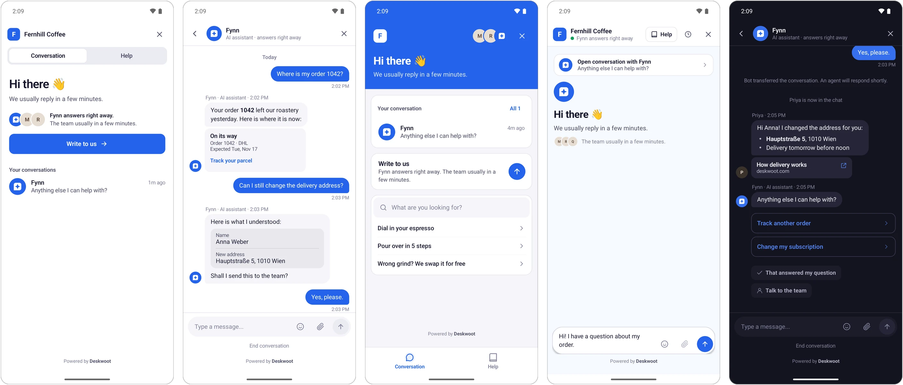

# Deskwoot Android SDK

Deskwoot's chat for your Android app. The SDK shows the same messenger your website shows (the inbox's brand color, texts, team, AI agent, help center and settings) as a native screen of your app: no web view for the chat, only the system's Android views.



It talks to Deskwoot's public widget API with the inbox's widget token. Visitors write, the team and the AI agent answer in Deskwoot, and replies reach the app while it is open.

## Requirements

- minSdk 21 (Android 5.0).
- Your app compiles against API 34 or later (the SDK uses `androidx.activity` 1.9 and `androidx.core` 1.13, which ask for that).
- Kotlin 1.9 or later, or Java. The SDK is compiled with Kotlin language and API version 2.0 to Java 17 bytecode (Android Gradle Plugin 8 or later).
- Works in apps built with Views and in apps built with Jetpack Compose. The SDK itself uses neither Compose nor AppCompat nor Material Components, so their versions never clash with yours.

## Install

The SDK is on Maven Central as `com.deskwoot:deskwoot-android` (an AAR with its sources, its API documentation and its POM):

```kotlin
// settings.gradle.kts
dependencyResolutionManagement {
    repositories {
        google()
        mavenCentral()
    }
}

// app/build.gradle.kts
dependencies {
    implementation("com.deskwoot:deskwoot-android:1.0.0")
}
```

To build it yourself, publish it from this repository into your local Maven repository and put `mavenLocal()` first:

```sh
./gradlew :deskwoot:publishToMavenLocal
```

```kotlin
// settings.gradle.kts
dependencyResolutionManagement {
    repositories {
        mavenLocal {
            content { includeGroup("com.deskwoot") }
        }
        google()
        mavenCentral()
    }
}
```

The SDK brings `androidx.core`, `androidx.activity` and `androidx.annotation` onto your app's compile classpath (its public classes build on them), and `kotlinx-coroutines-android` and `androidx.recyclerview` at runtime only. An app minified with R8 needs no rules of its own for it.

## Setup in 3 steps

1. Add the dependency.
2. Call `setup` once with the widget token of your Live Chat inbox (in Deskwoot: Settings, Inboxes, your inbox, Chat in your iOS and Android app). The best place is `Application.onCreate`: on the main thread it only creates the session (it reads no file, preference or system service there; the rest loads in the background), and before you call it the SDK only keeps the application context in its file provider.
3. Open the messenger where your app offers help.

```kotlin
class App : Application() {
    override fun onCreate() {
        super.onCreate()
        Deskwoot.setup(this, "YOUR_WIDGET_TOKEN")
    }
}

// In an Activity, for example behind a "Help" button:
Deskwoot.present(this)
```

```java
public class App extends Application {
    @Override
    public void onCreate() {
        super.onCreate();
        Deskwoot.setup(this, "YOUR_WIDGET_TOKEN");
    }
}

Deskwoot.present(activity);
```

`present` works right after `setup`, also before the session has loaded: the messenger paints from its disk cache and waits for the rest by itself.

A second `setup` with the same token does nothing. One with another widget token ends the chat of the first inbox: an open messenger closes, and the next `present` opens the new inbox.

## Every public call

All calls may be made from any thread, in any order and more than once. Listeners are called on the main thread.

### Open and close

```kotlin
Deskwoot.present(activity)                    // the start page
Deskwoot.presentConversation(activity)        // the newest running conversation, or a new one
Deskwoot.presentNewConversation(activity, "I have a question about order 1042")  // the text waits in the field, not sent
Deskwoot.presentHelpCenter(activity)          // the help center (the start page when the inbox has none)
Deskwoot.dismiss()                            // closes the messenger if it is open
```

```java
Deskwoot.present(activity);
Deskwoot.presentConversation(activity);
Deskwoot.presentNewConversation(activity, "I have a question about order 1042");
Deskwoot.presentNewConversation(activity);
Deskwoot.presentHelpCenter(activity);
Deskwoot.dismiss();
```

Pass the Activity you call from. The messenger then stays in your app's task and takes its light or dark appearance from that Activity.

The text of `presentNewConversation` goes into the field once. When the inbox's look changes later while the messenger is open, the visitor stays in the conversation they are in, and the text is not put back.

### Your signed in user

```kotlin
Deskwoot.identify(
    DeskwootUser(
        identifier = "u_42",
        identifierHash = hashFromYourBackend,   // see below
        email = "anna@example.com",
        name = "Anna Weber",
    ),
)
Deskwoot.logout()   // when the user signs out: everything the SDK keeps about the visitor is deleted
```

```java
Deskwoot.identify(new DeskwootUser("u_42", hashFromYourBackend, "anna@example.com", "Anna Weber"));
Deskwoot.logout();
```

Without `identify` the visitor is anonymous and the SDK keeps their chat on the device. With it, the user's conversations follow them to every device and to your website.

`identifierHash` proves to Deskwoot that the app may speak for this user. Your backend computes it as the hex HMAC-SHA256 of the identifier with the inbox's identity secret; the secret never ships in the app. How to compute it and the optional signed attributes: https://deskwoot.com/docs/widget#identity

Call `identify` at every start of your app as soon as it knows its user (as a website passes the user on every page load), and again whenever the user signs in. Call `logout` when the user signs out, and also at a start where your app finds that its user's session is gone (it ended while the app was closed). Until one of the 2 comes, a user the SDK stored in an earlier launch stays dormant: their identity is neither used nor deleted, the chat runs as a new visitor (whose first message replaces the stored user), and a tap on that user's notification waits for your `identify`, at most 10 seconds. An `identify` of that user then takes the stored identity back at once; it is never used for anybody else.

When your app keeps its signed in user (and the `identifierHash` from your backend), call `identify` in `Application.onCreate` right after `setup`, and `logout` there when the sign in ended while the app was closed. Android can start your app's process for a tap on a notification without running any Activity of your app, so code in an Activity is too late for that tap:

```kotlin
class App : Application() {
    override fun onCreate() {
        super.onCreate()
        Deskwoot.setup(this, "YOUR_WIDGET_TOKEN")
        // Your app's stored sign in, if there is one (read it the way your app does).
        val user = storedUser()
        if (user != null) {
            Deskwoot.identify(DeskwootUser(user.id, user.deskwootHash))
        } else if (signInEndedWhileClosed()) {
            Deskwoot.logout()
        }
    }
}
```

```java
public class App extends Application {
    @Override
    public void onCreate() {
        super.onCreate();
        Deskwoot.setup(this, "YOUR_WIDGET_TOKEN");
        StoredUser user = storedUser();
        if (user != null) {
            Deskwoot.identify(new DeskwootUser(user.id, user.deskwootHash));
        } else if (signInEndedWhileClosed()) {
            Deskwoot.logout();
        }
    }
}
```

Call `logout` at a start only for such a reason: it also deletes the chat of a visitor who never signed in.

`logout`, and `identify` with another user, clear an open messenger inside the call: nothing of the previous visitor stays on screen, and a `presentNewConversation` right after it opens with its text for the new user.

What `logout` deletes: the visitor's record, the last thread kept for a quick first paint, the drafts, the help search, the pictures and file copies of the chat and the visitor's notifications, of every inbox your app set up. It does so also before `setup` and in a launch that never calls `setup`, and called on the main thread it returns once the stored visitor is deleted (it waits at most 200 ms; the disk work itself runs in the background). A `setup` with another inbox right after it does not stop it. One thing can stay: when the SDK sent a push registration for the visitor, it keeps the inbox, the visitor's bearer and the time until the server confirmed that the phone no longer takes that visitor's pushes, at most 30 days; that removal goes out at the next `setup` of any inbox or the next push token. An app that never calls `setPushToken` keeps nothing of a visitor who logged out. A cookieless inbox writes no record of its visitor, no thread and no removal record to the device.

When Android brings the messenger back after your app's process ended, its screens, drafts and search come back only for the same visitor; after a `logout`, or with another user (or your stored user before your `identify`), it opens on the start page.

### Unread replies

```kotlin
val count = Deskwoot.unreadCount
val listener = UnreadCountListener { count -> badge.text = count.toString() }
Deskwoot.addUnreadCountListener(listener)
Deskwoot.removeUnreadCountListener(listener)
```

```java
int count = Deskwoot.getUnreadCount();
UnreadCountListener listener = count -> badge.setText(String.valueOf(count));
Deskwoot.addUnreadCountListener(listener);
Deskwoot.removeUnreadCountListener(listener);
```

The listener hears changes only; read `unreadCount` for the first value. A `setup` with another widget token is a change too: the listener hears the new inbox's count, so a badge never keeps the old one.

### A reply while the messenger is closed

When a reply arrives while the app is in the foreground and the messenger is closed, a small card slides up at the bottom of your app: the writer's face and name and 2 lines of the reply. A tap opens that conversation. The card needs no permission and no system overlay, and it never shows over the messenger. Switch it off with:

```kotlin
Deskwoot.inAppNotificationsEnabled = false
```

```java
Deskwoot.setInAppNotificationsEnabled(false);
```

### Push notifications

Replies reach the visitor while your app is closed. The SDK has no Firebase dependency and never talks to Google: your app keeps its own Firebase Cloud Messaging, hands the SDK the registration token and passes Deskwoot's pushes on.

1. In Deskwoot (Settings, Inboxes, your inbox, Chat in your iOS and Android app): add your Firebase project's service account.
2. Hand over the token: from `onNewToken`, and once at every start.
3. In `onMessageReceived`, pass Deskwoot's pushes to the SDK; it draws the notification itself.

```kotlin
class AppMessagingService : FirebaseMessagingService() {
    override fun onNewToken(token: String) {
        Deskwoot.setPushToken(token)
    }

    override fun onMessageReceived(message: RemoteMessage) {
        if (Deskwoot.isDeskwootPush(message.data)) {
            Deskwoot.handlePush(this, message.data)
            return
        }
        // Your app's own pushes.
    }
}

// Once at every start, for example in Application.onCreate after Deskwoot.setup:
FirebaseMessaging.getInstance().token.addOnSuccessListener { token -> Deskwoot.setPushToken(token) }
```

```java
public class AppMessagingService extends FirebaseMessagingService {
    @Override
    public void onNewToken(@NonNull String token) {
        Deskwoot.setPushToken(token);
    }

    @Override
    public void onMessageReceived(@NonNull RemoteMessage message) {
        if (Deskwoot.isDeskwootPush(message.getData())) {
            Deskwoot.handlePush(this, message.getData());
            return;
        }
        // Your app's own pushes.
    }
}

// Once at every start, for example in Application.onCreate after Deskwoot.setup:
FirebaseMessaging.getInstance().getToken().addOnSuccessListener(Deskwoot::setPushToken);
```

An app that already receives Firebase pushes has such a service and only adds the 2 Deskwoot calls. A new one is registered in your manifest as Firebase asks for it, next to Firebase's own setup (the google-services plugin and its config file):

```xml
<service android:name=".AppMessagingService" android:exported="false">
    <intent-filter>
        <action android:name="com.google.firebase.MESSAGING_EVENT" />
    </intent-filter>
</service>
```

- A push is Deskwoot's when it comes from the inbox given to `setup`; pushes of another inbox and your own answer false. Call `setup` in `Application.onCreate`: a push may start your app's process, and before `setup` no push counts as Deskwoot's. In a process of your app that is not its default one (a service with its own `android:process`), `setup` starts nothing (no network, no writes to the device) until that process shows the messenger or hands a push to `handlePush`.
- Each push names the visitor it was sent for. A notification shows only for the visitor the SDK runs as, or for your signed in user it has stored and who waits for your `identify`. A push for a visitor this phone forgot (after `logout`, or `identify` of another user) shows nothing, and `handlePush` still answers true for it. A cookieless inbox keeps no visitor once your app's process ended, so its pushes show nothing then.
- `handlePush` posts the notification before it returns, on the thread you call it on (FCM's worker thread, or the main thread).
- The notification shows the writer's name and the reply's first lines, in the SDK's own channel ("Chat replies", in the chat's language). One per conversation: a newer reply replaces the older one. None shows while the visitor reads that conversation, and a reply the in app card already showed goes into the list without sound.
- The SDK takes its notifications away again: all of them when the visitor ends (`logout`, `identify` of another user, a refused identity), and a conversation's own when the visitor reads it in the messenger. Your app's own notifications are never touched.
- A tap on a notification of the visitor the SDK runs as opens that conversation; the messenger shows its loading state until it knows who the visitor is. A tap on a notification of your stored signed in user waits for your `identify` of that user, at most 10 seconds from the tap, under the loading state with its close button; the conversation opens once the identity is verified. When the 10 seconds pass, or `identify` names another user, or `logout` comes, the messenger shows what it shows without a tap (the start page when it just opened). A conversation the server does not show to this visitor, and a notification of a visitor this phone forgot, open the start page. A later tap replaces an earlier one, also while the messenger is open, and a tap that still waits survives the messenger being made again (a switch of light or dark, for example).
- A tap after your app's process ended starts the session of that notification's inbox if your app has not called `setup` yet. When your app had no task any more (it was swiped away from Recents, or its process ended), your app's launch Activity goes under the messenger: Back from the messenger leads into your app, and your app stays in Recents.
- The phone registers as soon as the visitor is someone Deskwoot knows (a returning visitor at once, a new one after the first message) and again when the visitor changes; `logout` takes it off. When that cannot go out at once (no token yet, no network), the SDK keeps what it needs for it and sends it later (see "What `logout` deletes"). The token stays in memory only.
- Permission: on Android 13 and later your app needs `POST_NOTIFICATIONS`. Declare it in your manifest and ask for it when it suits your app. The SDK never asks; without the permission no notification shows and nothing fails (`handlePush` still answers true for Deskwoot's pushes).
- Icon: your app's icon by default. Android draws the small icon as a white silhouette, so a full color launcher icon shows as a white disc; name a one color drawable of your app instead:

```kotlin
Deskwoot.setNotificationIcon(R.drawable.ic_notification)
```

```java
Deskwoot.setNotificationIcon(R.drawable.ic_notification);
```

### Launcher

The round chat button of the web widget, above your app's content (the brand color, the inbox's side, a badge with the unread count). Hidden by default.

```kotlin
Deskwoot.setLauncherVisible(true)
Deskwoot.setLauncherBottomPadding(64)                          // dp, for example above your bottom navigation bar
Deskwoot.excludeFromOverlays(CheckoutActivity::class.java)     // no launcher and no card over this screen
```

```java
Deskwoot.setLauncherVisible(true);
Deskwoot.setLauncherBottomPadding(64);
Deskwoot.excludeFromOverlays(CheckoutActivity.class);
```

Most apps open the messenger from their own help button instead.

The launcher sits 16 dp above the navigation bar (and above the keyboard in an edge to edge app); `setLauncherBottomPadding` lifts it, and the in app card above it, by that much more. It steps aside while your app shows a dialog, a sheet or a menu over its screen. Neither the launcher nor the card ever shows over the messenger, over a translucent or floating Activity (a dialog Activity, the screens of payment and sign in SDKs) or over an Activity you exclude (and its subclasses). Both follow the light or dark mode of your Activity, also one your app forces on it, and are drawn again when the inbox's brand color or the chat's language changes. They read in the chat's direction (Arabic right to left, also over an app in English); the launcher keeps the inbox's side of the screen, left or right. In landscape both keep clear of the system bars and a display cutout.

### Theme

```kotlin
Deskwoot.theme = Deskwoot.Theme.SYSTEM   // the default: light or dark like the Activity that opens the messenger
Deskwoot.theme = Deskwoot.Theme.LIGHT
Deskwoot.theme = Deskwoot.Theme.DARK
Deskwoot.theme = Deskwoot.Theme.INBOX    // the inbox's own setting, as on the website
```

```java
Deskwoot.setTheme(Deskwoot.Theme.DARK);
```

Colors come from the inbox's brand color, in a light and a dark variant that keep every text readable; a brand color too close to the background (white, yellow, black) gets a thin edge on what is filled with it. Text sizes are in sp, so they follow the system's font size.

### Design

The messenger takes the inbox's design (in Deskwoot: Settings, Inboxes, your inbox, Look): nothing to do in the app. The SDK reads it from the inbox's settings as `widgetDesign`: `klartext`, `empfang` or `direkt`, the code names of Plain, Welcome and Direct.

- **Plain**, the default (also for a value the SDK does not know): a simple top bar with Conversation and Help, the start page as text with one button.
- **Welcome**: a hero on the inbox's color, cards on a gray canvas, the tabs at the bottom, the chat header on the color.
- **Direct**: the chat is the start page; the help, the conversation list, a collection and an article open as sheets over it, and articles that fit what a new visitor types show under the field.

The design, the brand color, the texts and the inbox's language reach the app whenever the SDK loads the inbox's settings: at `setup`, at every `present` call (also while the messenger is open), whenever your app comes back to the foreground, when your app hands a Deskwoot push to `handlePush`, when `Deskwoot.language` changes, and when a conversation comes on screen more than a minute after the last load. Nothing loads them on a timer. An open messenger is then built again in the new look on the screen the visitor is on: the same conversation, the same draft, the same list or article.

### Language

```kotlin
Deskwoot.language = "de"   // a BCP 47 tag in place of your app's language; null (the default) follows your app
```

```java
Deskwoot.setLanguage("de");
```

The messenger speaks English, German (with the inbox's choice of "du" or "Sie"), Spanish, French, Brazilian Portuguese, Italian, Japanese, Chinese, Hindi and Arabic. Which one:

1. The inbox's fixed language (in Deskwoot: Settings, Inboxes, your inbox, Welcome and language, Language of the chat), when it is not Automatic. It always wins, also over `Deskwoot.language`.
2. Without one, your app's language: the phone's language, or your app's own when the user set one for it (Android 13 and later), as `configuration.locales[0]` of your app's resources reads it. `Deskwoot.language` takes the place of this app language, and only of it. It lives in memory for the process and stays after `logout`.
3. A language the messenger does not speak falls back to English.

The iOS SDK reads the app's language the iOS way: the language the app runs in, the best of the phone's languages that the app ships. Each SDK follows its own platform's meaning of "the app's language", so an Android phone and an iPhone with the same settings may show the chat in different languages.

Every text and every accessibility label is in that one language, counts with its own plural forms (Arabic's 6 included). If your app filters its resources by language (`androidResources.localeFilters`), the messenger can only use the languages you keep.

Arabic reads right to left on every surface: the screens, Direct's sheets, Welcome's tab bar, the image viewer, the in app card and the launcher. Android lays out right to left only in apps that declare `android:supportsRtl="true"` on their `<application>` (new Android Studio projects do); without it the texts are Arabic but every layout stays left to right.

### Developer log

```kotlin
Deskwoot.logLevel = Deskwoot.LogLevel.ERRORS   // NONE (default), ERRORS, DEBUG
```

At `ERRORS` the SDK writes one line, tagged `Deskwoot`, for each thing you must fix: an unknown widget token, a refused identity and why. Secrets (the visitor's key, signatures, tokens) are never written.

## UI tests

Every control of the messenger has a stable view id. Use them with Espresso (`withId(com.deskwoot.sdk.R.id.dw_write_to_us)`), UI Automator or Maestro (`id: "dw_write_to_us"`):

| Area | Ids |
|---|---|
| Messenger | `dw_messenger_root`, `dw_screen_container`, `dw_loading`, `dw_load_error`, `dw_retry`, `dw_close`, `dw_back`, `dw_header`, `dw_header_title`, `dw_header_subtitle`, `dw_header_face`, `dw_open_in_help_center`, `dw_announcer` |
| Start page | `dw_start_screen`, `dw_tab_conversation`, `dw_tab_help`, `dw_business_name`, `dw_welcome_title`, `dw_welcome_tagline`, `dw_team_line`, `dw_write_to_us`, `dw_see_all_conversations`, `dw_conversation_row`, `dw_powered_by` |
| Thread | `dw_thread_screen`, `dw_thread_list`, `dw_new_messages_chip`, `dw_day_line`, `dw_activity_line`, `dw_divider`, `dw_bubble`, `dw_bubble_text`, `dw_who_line`, `dw_message_time`, `dw_link_card`, `dw_tracking_card`, `dw_tracking_link`, `dw_reply_quote`, `dw_image_attachment`, `dw_file_attachment`, `dw_help_article_card`, `dw_typing`, `dw_choice_button`, `dw_fynn_resolved`, `dw_fynn_team`, `dw_fixed_buttons_error`, `dw_send_failed_line`, `dw_retry_send`, `dw_discard_send`, `dw_upload_row`, `dw_queue_line`, `dw_offline_line`, `dw_closed_line`, `dw_end_conversation`, `dw_end_failed`, `dw_start_new_conversation` |
| Survey and transcript | `dw_csat_card`, `dw_csat_rating`, `dw_csat_comment`, `dw_csat_submit`, `dw_csat_error`, `dw_transcript_banner`, `dw_transcript_send`, `dw_transcript_email`, `dw_transcript_submit` |
| Composer | `dw_composer`, `dw_composer_input`, `dw_composer_send`, `dw_composer_attach`, `dw_composer_emoji`, `dw_composer_error`, `dw_reply_bar`, `dw_reply_cancel`, `dw_emoji_panel`, `dw_emoji` |
| Before the chat | `dw_gate_screen`, `dw_gate_intro`, `dw_gate_field`, `dw_gate_email`, `dw_field_error`, `dw_gate_submit`, `dw_gate_cancel` |
| Conversations | `dw_conversations_screen`, `dw_conversations_list`, `dw_no_conversations`, `dw_new_conversation` |
| Help center | `dw_help_screen`, `dw_help_search`, `dw_help_search_clear`, `dw_collection_row`, `dw_article_row`, `dw_help_results_label`, `dw_ask_card`, `dw_ask_button`, `dw_collection_screen`, `dw_article_screen`, `dw_article_title`, `dw_article_body`, `dw_vote_yes`, `dw_vote_no`, `dw_vote_thanks` |
| Welcome and Direct | `dw_tab_bar`, `dw_recent_card`, `dw_help_card`, `dw_header_help`, `dw_header_conversations`, `dw_header_badge`, `dw_sheet`, `dw_greeting_block`, `dw_open_conversation_banner`, `dw_article_tray`, `dw_article_ask_bar`, `dw_composer_article`, `dw_composer_article_remove` |
| Image viewer | `dw_image_viewer`, `dw_viewer_image`, `dw_viewer_share`, `dw_viewer_close` |
| Over your app | `dw_in_app_card`, `dw_in_app_card_close`, `dw_launcher`, `dw_launcher_badge` |

Rows that repeat (`dw_conversation_row`, `dw_bubble`, `dw_choice_button` and the like) share their id; pick one by index or by its text.

`dw_article_body` is the frame that holds an article's text, and UI Automator and Maestro find it by that id. The text inside is a WebView, which carries no id of its own (a phone without a usable WebView shows the text as a plain text view under the same id): find words of the article by their text, not by an id.

These ids are the SDK's only public resources. Everything else (texts, styles, drawables, colors) starts with `dw_` and is private: Android Studio does not offer it, and lint warns when your app uses or overrides it.

## What the SDK adds to your app

| | |
|---|---|
| Permissions | `INTERNET` only. The camera in the attachment menu goes through the system camera app; the SDK asks for the camera permission only when your app declares it itself (Android then requires it). Photos come from the system photo picker, files from the system document picker; neither needs a permission. |
| Components | 1 Activity (`DeskwootActivity`, not exported) and 1 FileProvider (`DeskwootFileProvider`, not exported, authority `<applicationId>.deskwoot.files`, only for photos taken with the camera and files opened from the chat). A FileProvider is a ContentProvider, so Android creates it when your app's default process starts, before `Application.onCreate`, as it does every provider in the manifest; it only keeps the application context then (no disk, no network), so a `logout` before `setup` can delete what an earlier launch stored, and reads its folder list only when a file is shared. No service, no receiver. 1 notification channel (`deskwoot_messages`), created the first time `handlePush` shows a notification. |
| Dependencies | `kotlinx-coroutines-android`, `androidx.annotation`, `androidx.core`, `androidx.activity` and `androidx.recyclerview`, with what they bring themselves (`androidx.lifecycle`, `androidx.savedstate`, `androidx.collection` and the like), but without `androidx.profileinstaller`: it would add a ContentProvider that starts with your app and an exported receiver. No OkHttp, no Retrofit, no JSON library, no image library, no Firebase, no Compose. androidx.core declares its own `DYNAMIC_RECEIVER_NOT_EXPORTED_PERMISSION`, a signature permission every app with androidx.core 1.9 or later already has. |
| Size | The release AAR is 1.7 MB, its sources jar 0.3 MB. In an app with one screen built with Views and minified with R8, the SDK made the APK 0.7 MB larger (724 KB against 23 KB without it), with everything it brings (Kotlin standard library, coroutines, androidx core, activity, lifecycle and recyclerview); an app that already ships those pays less. Android Studio's APK Analyzer shows it for your build. |
| Start cost | `setup` creates the session on the main thread and reads no file (on Android 8.1 and older only the name of its own process, from the kernel, not from storage), preference or system service there; the visitor's store, the server address and the first request run in the background. Nothing runs before `setup`, except that a tap on one of the SDK's notifications sets up that notification's inbox when your app has not, and that `logout` deletes what an earlier launch stored. `handlePush` called on a worker thread before the visitor's store was read reads it on that thread. |
| Global changes | None: no reflection on your classes, and no theme or style of yours is changed. Of your Activities the SDK reads only whether one is translucent or floating (no launcher or card there) and its night mode (the launcher's and the card's light or dark). |

## Not in this version

- Sounds.

## Example app

`example/` is a small app that calls every public method behind a button. It is not part of the library. Its Maestro flows are in `example/maestro/`; each run writes its screenshots into Maestro's output folder.

The app reads 3 settings at build time, each from a Gradle property (`-P...` or `~/.gradle/gradle.properties`), else from an environment variable, else from the project's `local.properties` (which is not checked in):

| Setting | Gradle property and `local.properties` key | Environment variable | Without it |
|---|---|---|---|
| Your inbox's widget token | `deskwootWidgetToken` | `DESKWOOT_WIDGET_TOKEN` | `YOUR_WIDGET_TOKEN`, which the server refuses |
| The server | `deskwootBaseUrl` | `DESKWOOT_BASE_URL` | `https://deskwoot.com` |
| The email of the test user behind `identify(user_4711)` | `deskwootTestEmail` | `DESKWOOT_TEST_EMAIL` | none |

```properties
# local.properties
deskwootWidgetToken=YOUR_WIDGET_TOKEN
# Only for a Deskwoot server on your own computer, as the emulator reaches it:
deskwootBaseUrl=http://10.0.2.2:3000
```

```sh
./gradlew :example:installDebug
# The same for one build only:
./gradlew :example:installDebug -PdeskwootWidgetToken=YOUR_WIDGET_TOKEN -PdeskwootBaseUrl=http://10.0.2.2:3000
maestro test -e TEST_EMAIL="$DESKWOOT_TEST_EMAIL" example/maestro
```

Debug builds of the example hand a push to the SDK without Firebase: type a conversation id and the visitor key (the first 16 hex characters of the SHA-256 of the visitor's bearer, as the server sends it) into the fields and tap `handlePush(debug push)`. `identify(user_4711)` stores that the example has a signed in user, and the example then calls `identify` in `Application.onCreate` right after `setup`; `logout()` and the switch `identify in Application.onCreate` turn that off, so a tap can be checked with the user named at the start and with the user left waiting.

The first flow types `TEST_EMAIL` into the step before the chat, and the server takes it as the visitor's address, so name a mailbox you read (the step refuses test domains such as example.com, as the web messenger does); the other flows do not use it. The example allows plain HTTP only to `10.0.2.2` and `localhost`. Its `identify(user_4711)` button signs the test user with an identity secret that belongs to a local test inbox only (`LOCAL_IDENTITY_SECRET` in `example/build.gradle.kts`); a real app never holds an identity secret, its backend computes the hash.

## Build and test

```sh
./gradlew :deskwoot:assembleRelease :deskwoot:testDebugUnitTest :example:assembleDebug --max-workers=4
```

How the SDK is built inside, and where each rule of the widget protocol lives: [ARCHITECTURE.md](ARCHITECTURE.md).

## License

MIT, see [LICENSE](LICENSE).
